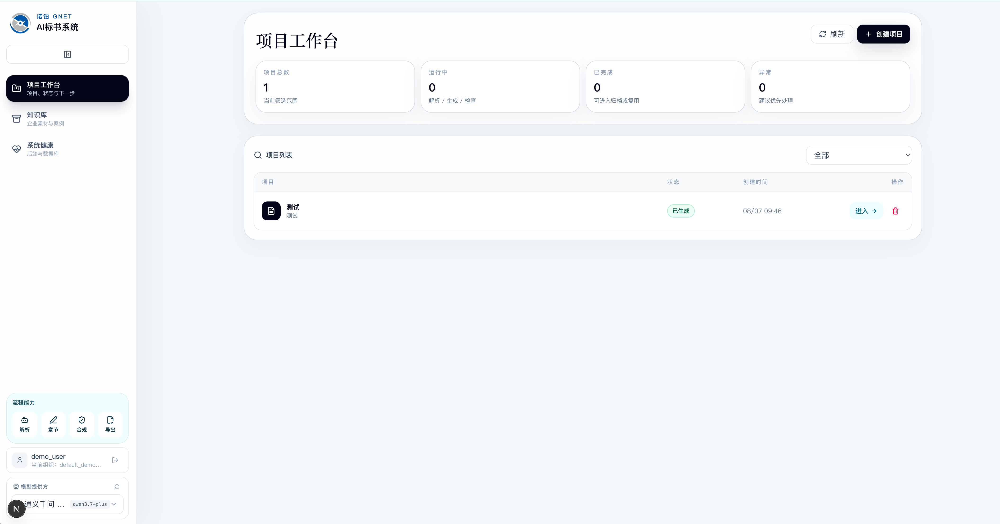
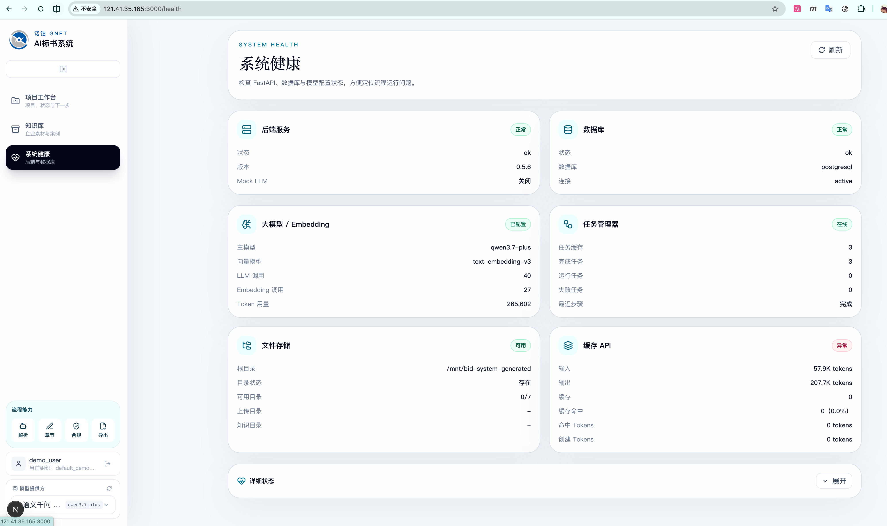
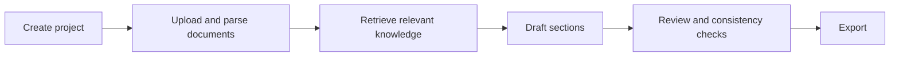

# AI Bidding Platform — Product Case Study

*A personal portfolio summary of a team-built AI tender document workflow. The original application source, customer documents, prompts, credentials, and deployment configuration remain private because they include confidential project material.*

**Open the deployed platform:** [AI bidding system](http://121.41.35.165:3000/) · [System health page](http://121.41.35.165:3000/health). Both routes currently redirect visitors to login; a platform account is required to view the application. Availability and access may change.

## Interface screenshots

### Project workbench

This screenshot shows a demo workbench with a project list, project status, knowledge library, and system health navigation. It does not show a completed tender document or validate the quality of generated content.

### System health

This is a historical screenshot of the demo environment's service, database, model, and task diagnostics. Its labels and status values describe that moment only; they are not a live uptime or performance claim. The public screenshot does not provide access to the private source or configuration.

## Workflow and architecture

The product brings tender materials, enterprise knowledge, drafting tasks, checks, and export into one reviewable workflow. A typical path is:

The private local project contains a web frontend and backend services. Its public-facing architecture can be described as a Next.js interface, FastAPI APIs, PostgreSQL-backed project data, document processing, retrieval, task orchestration, and optional model calls. The diagram omits internal endpoints, prompts, infrastructure, and customer data.

## Problem, approach, and observable outcome

| Problem | Approach | Observable outcome |
| --- | --- | --- |
| Tender work is split across documents, reference material, and multiple drafting steps. | Put projects, status, and next actions into one workbench. | The demo workbench displays projects and their states in one view. |
| Drafting needs relevant source material and human review. | Separate parsing and knowledge retrieval from drafting, with later checks and export stages. | The interface exposes these workflow stages; this case study does not claim measured drafting quality or time savings. |
| Long-running tasks and service dependencies can be hard to diagnose. | Provide task status and system health views. | Operators have a place to inspect service and task state. |

This is a team product. I can discuss my specific implementation role and walk through allowed screens in a project conversation. The screenshot and flow show product capabilities, not a claim that I built every module alone.

## Public code sample

The separate [Grounded Document Workflow demo](https://github.com/Deng-summer/grounded-document-workflow-demo) is original sample code using invented content. It demonstrates document chunking, retrieval, evidence-linked drafting, and citation validation. It is **not** the private platform's source code or its deployed backend.

Some separately reviewed, non-confidential code may be released later. This repository currently contains only the case study and interface screenshots.

© 2026 Deng-summer. Personal portfolio summary; not official company documentation.
